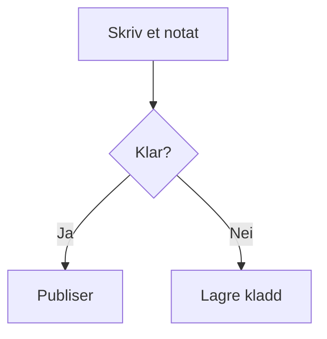

# Mermaid Diagrams

Frakoblet Mermaid-forhåndsvisning og diagrammaler for Noteriv på desktop, Android og iOS.

1. Pakk ut ZIP-filen og velg mappen `mermaid-diagrams` under **Install plugin from folder** på mobil eller **Community Plugins → Installed → Install** på desktop.
2. Aktiver **Mermaid Diagrams**. Bruk en appversjon med støtte for pluginressurser.
3. Bruk **Sett inn Mermaid** i kommandopaletten mens du redigerer et notat. Velg flytskjema, sekvens- eller tilstandsdiagram.
4. Gå til lesevisning og trykk **Vis Mermaid-diagram**.

````markdown

````

Bruk `mermaid-offline` for å velge den medfølgende motoren. Vanlige `mermaid`-blokker bruker Noterivs innebygde visning.

Bygg en installerbar mappe fra repo-roten med `node desktop/examples/plugins/build-diagram-plugins.mjs /sti/til/utdata`.
