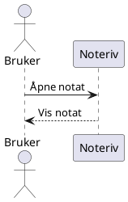

# PlantUML

Forhåndsvis PlantUML-diagrammer lokalt i Noteriv på desktop, Android og iOS.

1. Pakk ut ZIP-filen og velg mappen `plantuml` under **Install plugin from folder** på mobil eller **Community Plugins → Installed → Install** på desktop.
2. Aktiver **PlantUML**. Bruk en appversjon med støtte for pluginressurser.
3. Bruk **Sett inn PlantUML** i kommandopaletten mens du redigerer et notat. Velg sekvens-, klasse- eller aktivitetsdiagram.
4. Gå til lesevisning og trykk **Vis PlantUML-diagram**.

````markdown

````

Motoren følger med pluginen. Selve tegningen skjer lokalt i et isolert nettleserdokument. Eksterne inkluderingsfiler og standardbiblioteker utenfor pakken støttes ikke.

Bygg en installerbar mappe fra repo-roten med `node desktop/examples/plugins/build-diagram-plugins.mjs /sti/til/utdata`.
